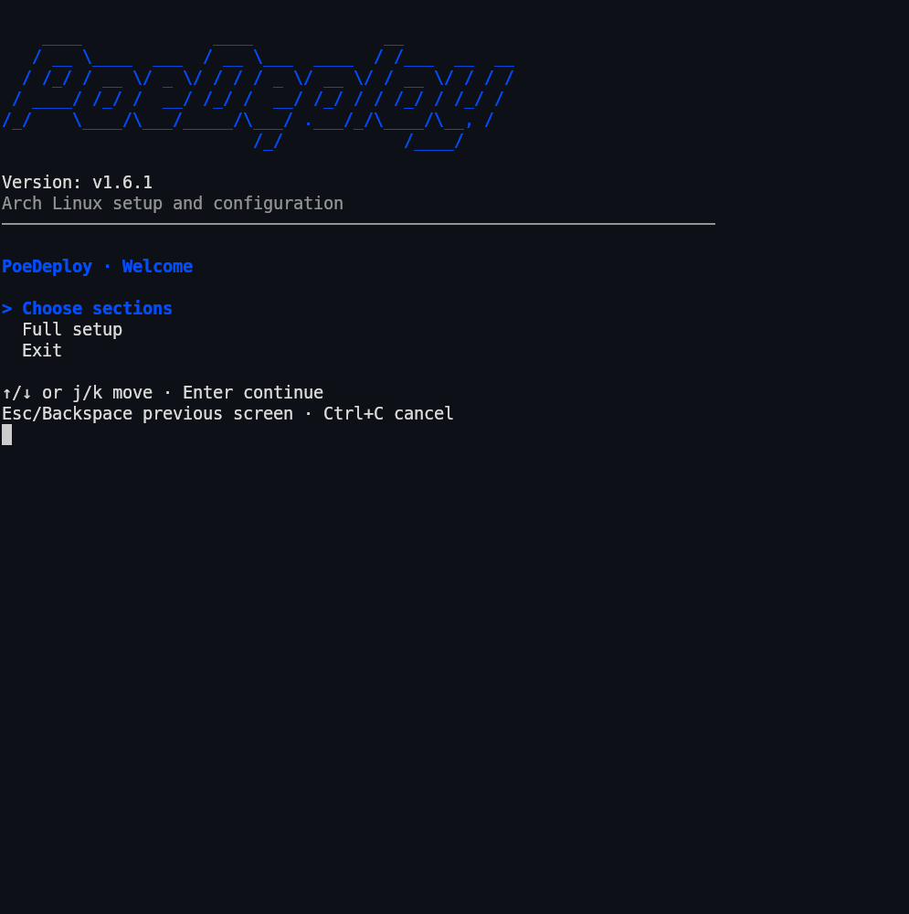
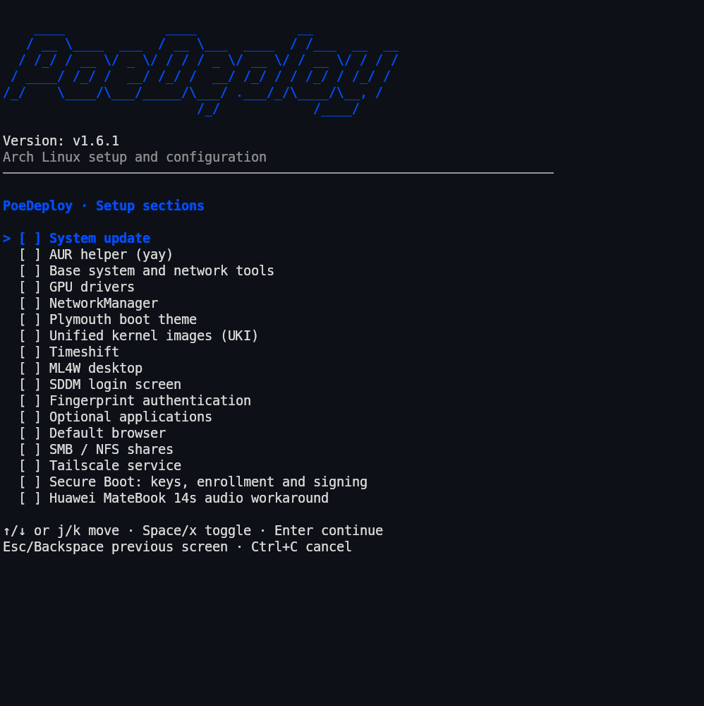
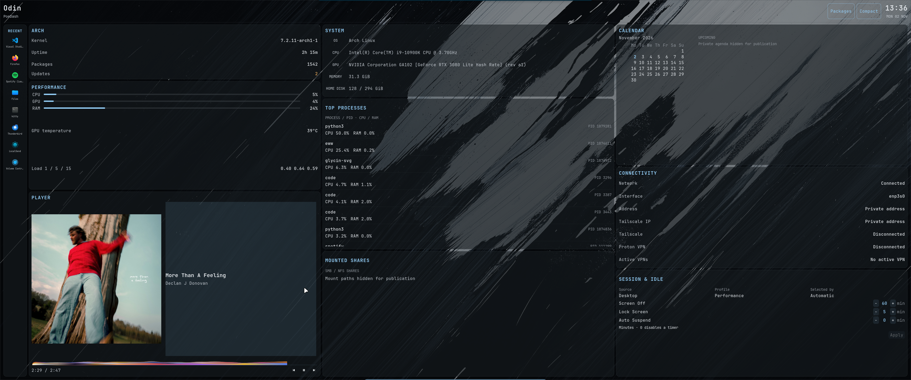
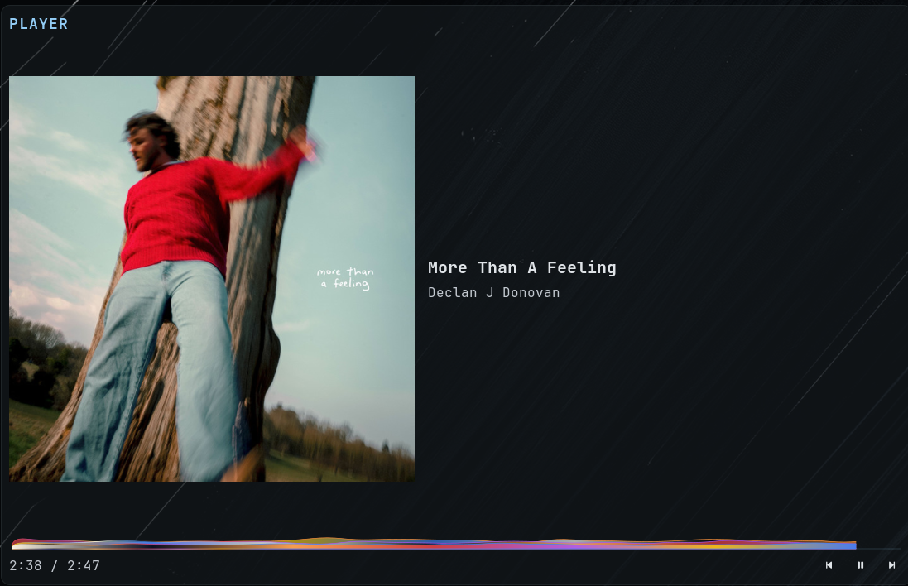
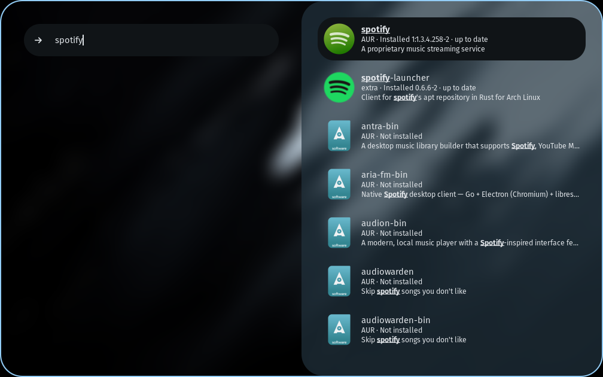
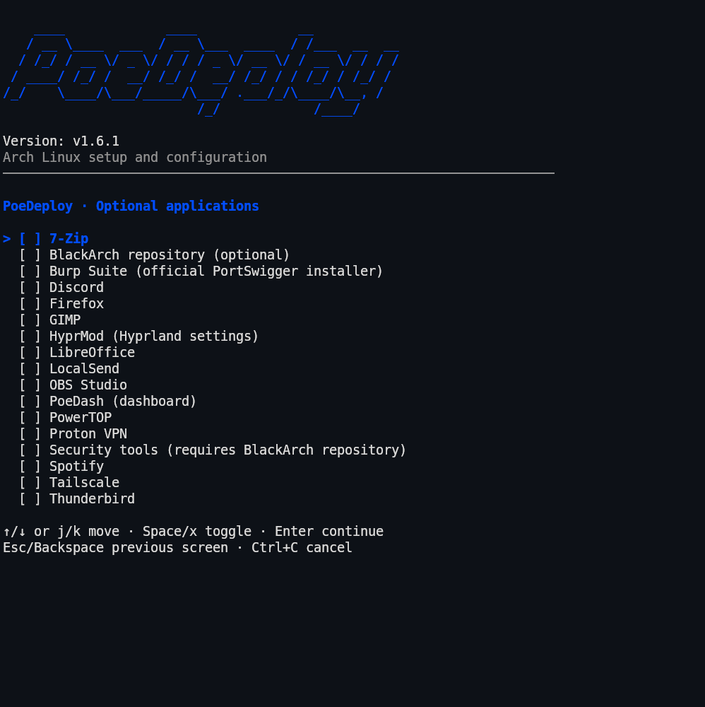

# PoeDeploy

<p align="center">
  
</p>

An interactive Arch Linux setup script, with a Hyprland desktop dashboard and
optional applications, networking, boot and hardware integrations.

I started PoeDeploy for my own machines and am opening it up so other people can
use the same workflows. Choose one component or run the full setup. You can
review and change the plan before installation starts.

[Start](#start-poedeploy) · [Components](#available-components) ·
[PoeDash](#poedash) · [Applications](#optional-applications) ·
[Development and AI](#development-and-ai)

## Start PoeDeploy

Use an installed Arch Linux system and run as your normal desktop user. PoeDeploy
asks for sudo only for operations that need it. Desktop features target Hyprland,
Eww and ML4W. Hardware-specific components are conditional, not universal fixes.
This script does not partition disks or replace an Arch installation guide.

```bash
bash <(curl -fsSL https://cyberpoe.uk/poedeploy-latest)
```

The launcher downloads the latest stable release and displays its version. If
Git is missing, it asks before installing it. You can also inspect a checkout:

```bash
git clone https://github.com/cyberpoe-uk/PoeDeploy.git
cd PoeDeploy
bash poedeploy.sh
```

Choose **Choose sections** for individual jobs or **Full setup** to visit the
available setup stages. Optional applications start unselected. Full setup skips
the Huawei audio workaround unless the exact supported hardware is detected.

<p align="center">
  
</p>

### Change your mind before installing

Interactive planning includes Welcome, setup sections, optional applications,
the dashboard subtitle and a final review. Arrow keys or `j/k` move, Space or `x`
toggles a checkbox, and Enter continues. Esc and Backspace return to the previous
screen. At the first screen, Esc cancels and Backspace stays there. Ctrl+C stops
the run. In a text field, Backspace edits text and returns when the field is empty.

Choices remain available when you go back. The review screen also has explicit
**Edit setup sections**, **Edit applications** and **Back to beginning** options.
No installer actions run until you select **Install selected sections**.
Noninteractive terminals retain the numbered fallback interface.

Going back changes the plan, not completed system changes. Once installation has
started, Ctrl+C stops the current operation using its normal cancellation flow.
Packages, keys and boot changes that already completed are not automatically
uninstalled or rolled back. Optional failures offer retry or skip where supported.

<p align="center">
  
</p>

The installer shows real stage progress, warnings and the log path. `L` opens the
live log, and `Q` or Esc returns from the log view. Interactive installers and
password prompts receive the terminal, then control returns to the dashboard.
Logs go to `/var/log/poedeploy.log` when writable, otherwise
`~/.local/state/poedeploy/poedeploy.log`.

To inspect an example progress view without changing the system:

```bash
bash poedeploy.sh --preview
```

## Available components

Each setup stage can be selected independently. Dependencies needed by that
stage may also be installed. Full setup follows the project's defined order.

### System update

Updates the installed system with pacman. It is separate from installing an
individual optional application.

### AUR helper: yay

Keeps an existing yay installation or builds it from the AUR with the necessary
build tools. Optional applications prefer repository packages when available.

### Base system and network tools

Installs common utilities for downloads, archives, diagnostics, SSH, SMB/NFS,
networking and basic system administration.

### GPU drivers

Detects the GPU and follows the existing vendor-specific installation path.
Review the detected hardware before changing a working driver setup.

### NetworkManager

Installs/enables NetworkManager for network connections and supported VPN clients.

### Plymouth boot themes

Offers the PoeDeploy theme and static/animated BlackArch colour variants, plus
existing themes. Keeping the current theme is an option. Boot-theme branding does
not install the BlackArch repository. [Theme files](themes/README.md).

### Unified kernel images: UKI

Assesses the bootloader and existing kernel setup before configuring supported
UKI workflows. [UKI and boot guide](docs/boot-and-secure-boot.md).

### Timeshift

Installs Timeshift and explains Btrfs or rsync snapshot options for the detected
filesystem. Configure and test your snapshot policy before relying on it.

### ML4W desktop

Runs the ML4W Hyprland desktop installation with visible interactive output.
Desktop and dotfile changes should be reviewed on an existing customised system.

### SDDM login screen

Offers the supported SDDM setup and ML4W theme, preserving existing configuration
backups where the installer manages files.

### Fingerprint authentication

Detects the reader, offers enrollment, and requires a successful verification
before enabling supported SDDM/Hyprlock login changes. Password login remains
available. The experimental Goodix GDIX51C0 path is pinned and requires consent.
It does not enable fingerprints for SSH or sudo.
[Hardware details and removal](docs/fingerprint.md).

### Optional applications

Choose the applications you want. PoeDash, VPN clients and security tools are
independent choices. See the [application list](#optional-applications).

### Default browser

Shows current defaults and offers installed browsers. Updates and verifies HTTP,
HTTPS and HTML associations while leaving the email application unchanged.

### SMB and NFS shares

Tests connectivity and user access before saving a mount in `/etc/fstab`.
Failed checks are not persisted. Use an empty mount point under `/mnt` or `/media`.
[Share setup guide](docs/network-shares.md).

### Tailscale

Installs Tailscale and enables `tailscaled`. Grants the validated desktop user
operator permissions so they can manage the local connection without sudo.
On graphical systems with a supported Tailscale version, it enables the official
systemd user-session tray, compatible with QuickShell's existing tray host.
Headless/chroot environments defer or skip graphical integration. Existing login
and authentication are retained. Connect initially with `tailscale up` when ready.

### Secure Boot

Provides explicit choices for keys, enrollment, signing and verification.
PoeDeploy does not treat firmware changes as a routine application installation.
Keep recovery media and read the [boot guide](docs/boot-and-secure-boot.md) before
using UKI or Secure Boot. [Kernel update validation](docs/kernel-update-check.md).

### Huawei MateBook 14s audio

Optional, restricted to DMI product **HKF-WXX** and codec subsystem
**0x19e53285**. Full setup skips it on other hardware. Runtime routing rechecks
both identities and discovers the codec without assuming card 0.
An event-driven ALSA listener handles speaker/headphone routing and resume,
working below PulseAudio or PipeWire. It preserves SOF, microphones and normal
output switching, without continuous polling. Speaker routing was physically
confirmed on the affected laptop. Persistent headphone, resume and power-saving
behavior still require on-device testing.
[Workaround, logs and removal](docs/matebook-audio.md).

## PoeDash

PoeDash is the single dashboard bundled with PoeDeploy. It places your hostname
above a themed desktop overview on workspace 1, with application windows above
it. It uses Eww and integrates with supported ML4W QuickShell/Waybar controls.

<p align="center">
  
</p>

The dashboard image is captured from the development PC. Personal agenda entries
and network addresses are hidden for publication. Appearance and readings depend
on your display, theme, installed applications and hardware.

### Layout and applications

The wide layout has three columns:

| | | |
| --- | --- | --- |
| Arch | System | Calendar |
| Performance | Top Processes | Connectivity |
| Player | Mounted Shares | Session & Idle |

Cards adapt to logical display size, including scaling and resolutions through
4K. Compact and Comfortable switch live and persist across restarts. Compact uses
smaller text while retaining card bounds and recent-app icon/name sizes. Smaller
screens use fewer columns and bounded internal scrolling for long content.

A narrow app rail stays below the hostname. Right-click to pin/unpin an app.
Pinned entries stay above recent apps, separated by a subtle line. Clicking an
entry focuses its window or launches it. After the last normal application window
closes, PoeDash returns to workspace 1. Visiting an empty workspace manually does
not trigger this behavior.

### Battery-aware refresh

On battery, a hidden dashboard keeps its last values and pauses metric collectors,
clock/calendar polls, UI updates and the audio monitor. Returning to its workspace
resumes refreshes. On AC, refreshes continue even when the dashboard is hidden.
Lightweight workspace/power checks remain available so these transitions work.
Actual power-profile management and idle enforcement continue independently.

Visible general metrics normally update every two seconds on battery. The Power
readings use **five seconds on battery and one second on AC**. Playing media is
sampled every second. Laptop GPU telemetry is passive by default.

### Player and seekable audio wave

Album artwork grows with its card. Click artwork or a song title to open the
playing application. Click or drag the wave/progress slider to seek in a track.
Streams without a known duration cannot seek.

<p align="center">
  
</p>

Overlapping mountain ridges rise from a fixed bottom edge and grow with playback
progress, with no position dot. Red, purple, yellow, blue, white, black and orange
replace the green palette.
It uses the real audio output monitor, not a decorative animation.
Cava is used when available, with a built-in `parec`/libpulse fallback compatible
with PulseAudio and PipeWire's PulseAudio service. Audio is not recorded to disk,
and the microphone is not selected. Animation runs only during playback, at a
lower frame rate on battery, and stops when the hidden dashboard is paused.

With no connected player, Play can launch Spotify on workspace 2 without taking
focus, then ask it to resume its saved context. PoeDash also remembers the last
observed Spotify track URL as a fallback. Spotify must be signed in and have a
playable context, so a first-time account may need you to choose a track once.
If Spotify is missing, approval opens package search prefilled with **spotify**
so you can choose a version. Nothing is installed without the normal confirmations.

### Calendar

The month grid opens Thunderbird Calendar. The agenda reads up to eight upcoming
events over the next 14 days from enabled local/offline calendar data.
Locked databases are handled through checked private copies with their journals.
PoeDash does not synchronize or modify event data itself.

On startup/refresh it checks for installed Thunderbird and offers to enable
remote-calendar offline caching. Consent is remembered per profile and calendar.
New calendars require their own approval. Restart Thunderbird and synchronize
after enabling caching. The regular agenda poll stays read-only.

### Package search

Packages opens in your current Rofi size and theme, searching all configured
repositories and the AUR immediately. Catalogs refresh on opening, in a separate
search database. Type while they load. Alt+R or **Choose repository** narrows the
source while keeping the query.

Results with available application icons appear first, then plain entries,
alphabetically within each group. Repository, installed/update status and short
descriptions appear underneath. Select **Full description**, or highlight a
package and press **Alt+D**, for full details. These replace hover tooltips that
Rofi's list does not provide natively.

<p align="center">
  
</p>

**Install** is the first action and changes the selection plus required
dependencies using existing package databases. **Install and upgrade** is second
and includes a full system upgrade. Outdated packages offer equivalent Update
choices. Both open an interactive terminal for confirmation, passwords and AUR
review. Searching never installs packages.
[Cache, offline behavior and commands](docs/package-search.md).

### Session, idle and Power

Source, Profile and Selected by explain the system power state. QuickShell keeps
its existing profile-selection menu. Automatic means PoeDash chooses Power Saver
on battery and Performance on AC, with supported fallbacks. A manual profile
choice persists until a real power-source transition.

Screen Off, Lock Screen and Auto Suspend reflect the detected Hypridle timers.
Numeric controls preserve unrelated listeners and security hooks, make backups,
and verify changes. Zero disables the corresponding timer. Unknown values are
shown as unavailable rather than guessed.

A **Power** subsection appears below the idle controls only while a detected
system battery is supplying power. It shows charge, current watts and the OS's
remaining-time estimate in hours/minutes when available. It is absent on batteryless
desktops and hidden while plugged in. Unknown time estimates stay unavailable.

```bash
poedash doctor
poedash power status
poedash power disable
poedash power enable
```

### Install, refresh and remove

Select PoeDash under Optional applications, or run its installer from a checkout:

```bash
bash apps/poedash/install.sh
```

The dashboard refresh button and `poedash update` use the maintained copy on the
repository's `main` branch. Normal PoeDeploy setup uses stable release tags.
Dashboard-only refresh preserves preferences, pins, theme and enabled state.
It runs in the background and shows a desktop notification when finished. Errors
are reported by notification and saved in `~/.cache/poedash/update.log`
(or under `$XDG_CACHE_HOME`).
It does not add repositories, install security tools or upgrade packages.
Recognised retired dashboard integrations are backed up and removed during
migration. Other Eww configurations are retained.

```bash
poedash reload
poedash update
poedash stop
poedash uninstall
```

User configuration is under `~/.config/poedash`, with backups under
`~/.local/state/poedash/backups`. [Dashboard guide](apps/README.md).

## Optional applications

These are choices, not a mandatory bundle. The installer shows selected packages
and runs their supported installation path.

| Application/component | Purpose |
| --- | --- |
| PoeDash | Workspace dashboard, media, calendar, power and package search |
| Firefox | Web browser |
| LocalSend | Local-network file sharing |
| VLC | Media player with the selected plugin bundle |
| Visual Studio Code | Code editor |
| 7-Zip | Archive tools |
| Discord | Messaging and communities |
| GIMP | Image editing |
| HyprMod | Hyprland settings |
| LibreOffice | Office applications |
| PowerTOP | Power diagnostics |
| Proton VPN | Official Arch GUI with NetworkManager/keyring dependencies |
| Tailscale | Mesh VPN and supported official tray integration |
| Thunderbird | Email and calendar |
| Spotify | Music playback through spotify-launcher |
| OBS Studio | Recording and streaming |
| BlackArch repository | Explicit optional repository setup |
| Security tools | ffuf, Gobuster, Nmap, sqlmap, Wfuzz, Wireshark and jwt-tool |
| Burp Suite | Official PortSwigger native installer with checksum verification |

<p align="center">
  
</p>

Security tools require the explicitly selected BlackArch repository. Burp uses
the official native installer, not an AUR build. Existing native installations
are retained and use Burp's own updater. These choices are independent of PoeDash.
Proton VPN requires sign-in, and split tunneling additionally needs
`systemd-resolved`. PoeDeploy does not change DNS configuration automatically.

## Development and AI

This project is AI-assisted, or “vibe coded” if you prefer. I use AI to help write,
refactor, explain and test code while building the setup I want for my own
machines. I make the project decisions and am responsible for what gets shipped.

AI-generated code and passing tests do not mean every laptop, GPU, firmware or
bootloader has been physically validated. Hardware-only limitations are called
out in the relevant guides. Bug reports with the version, selected stage and
sanitized logs help improve the project.

The screenshots show real installer menus, package results and this development
PC’s dashboard, with private fields hidden. They are interface references, not promises that another
machine has the same packages, battery, playback state or appearance.

```bash
python3 -m unittest discover -s tests -v
python3 -m unittest discover -s apps/poedash/tests -v
bash -n poedeploy.sh
bash -n poedeploy-latest
```

Installer stages are defined in `poedeploy.sh`, with modular helpers under
`installer/` and terminal rendering/navigation under `ui/`. PoeDash lives under
`apps/poedash/`, with shared desktop, layout and calendar helpers in `apps/shared/`.
Contributions should keep sections independent, preserve user configuration and
include meaningful checks for changed behavior.

Useful guides: [boot/UKI/Secure Boot](docs/boot-and-secure-boot.md),
[kernel updates](docs/kernel-update-check.md), [network shares](docs/network-shares.md),
[fingerprints](docs/fingerprint.md), [MateBook audio](docs/matebook-audio.md),
[package search](docs/package-search.md), [themes](themes/README.md).
